
<a href="https://123mikeyd.github.io/Nous_Research_Cinematic_Universe/library/">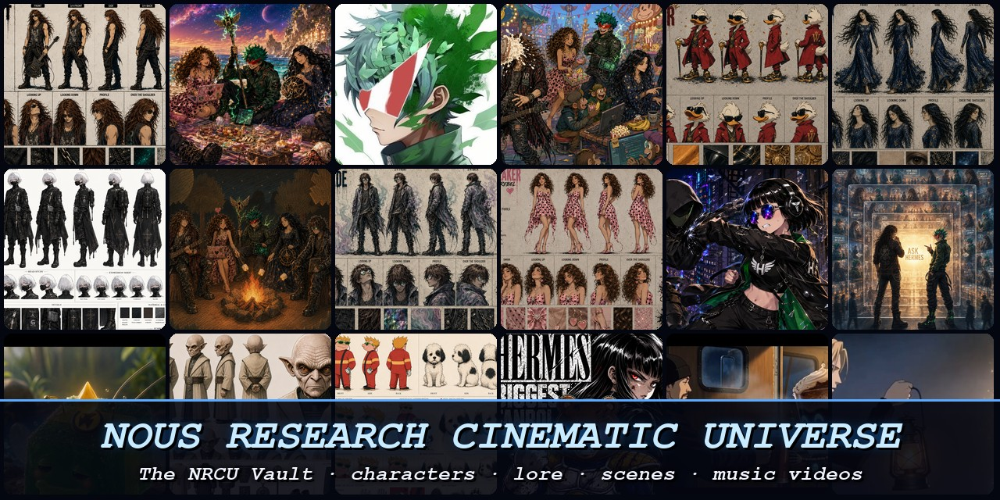</a>

# 🎬 Nous Research Cinematic Universe (NRCU)

> **"We Build. We Share. We Never Surrender."**

The NRCU is a **collaborative character bible and art archive** for a fan-created Nous universe: selected character designs, community stories, music videos, and game adaptations. The Hermes Agent Squad is part of that world—not the boundary of the cast.

**[Browse the character bible](https://123mikeyd.github.io/Nous_Research_Cinematic_Universe/library/)** · **[Co-artists & creative credits](./CREDITS.md)**

**NRCU co-artists:** [Mike / 123mikeyd (Doge Man)](./characters/doge-man.md), [ArtsBro](./characters/artsbro.md), [Sahil](./characters/sahil.md), and [Quark2world](./characters/quark2world.md). Real creator credits are separate from fictional roles and allegiances. Approved references stay selected; alternate art and open lore are labeled.

**Open Source for All.**

## 🖼️ NRCU Picture of the Month

**Artwork by [Quark2World](./characters/quark2world.md)**

  <a href="./images/spotlights/quark2world-comic.png">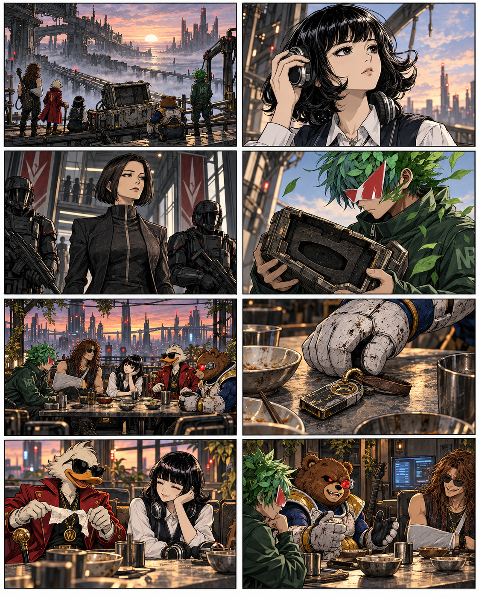</a>

<em>Even between big adventures, there's time to share a meal.</em> <a href="./images/spotlights/quark2world-comic.png">View full-size artwork</a>

---

## Explore the archive

**[Open the searchable visual library](https://123mikeyd.github.io/Nous_Research_Cinematic_Universe/library/)** · **[Alphabetical character directory](./characters/README.md)**

All Nous. One cast, in alphabetical order. Open any picture or name to read the profile and see the artwork—no model download needed.

## All Nous characters

<!-- BEGIN GENERATED CHARACTER GALLERY -->
<table>
<tr>
<td align="center"><a href="./characters/adolan.md">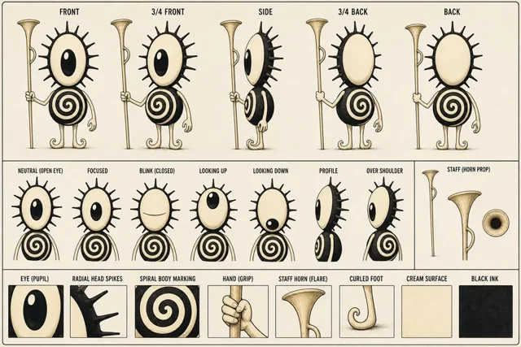 <strong>adolan</strong></a></td>
<td align="center"><a href="./characters/artsbro.md">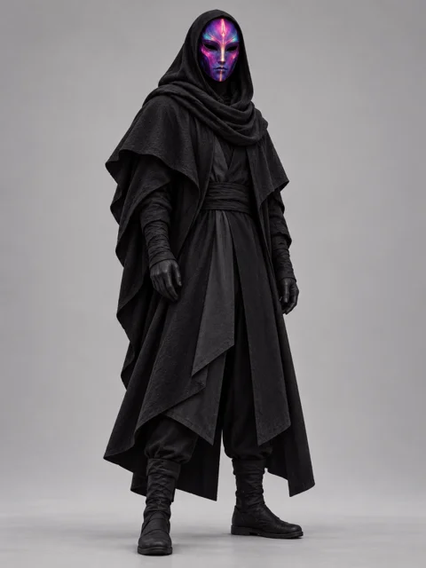 <strong>ArtsBro</strong></a></td>
<td align="center"><a href="./characters/cthulhu.md">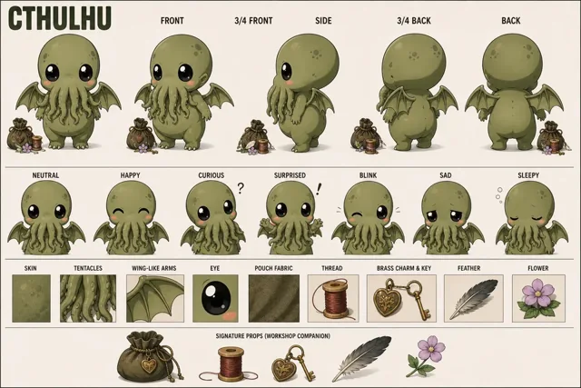 <strong>Cthulhu</strong></a></td>
<td align="center"><a href="./characters/doge-man.md">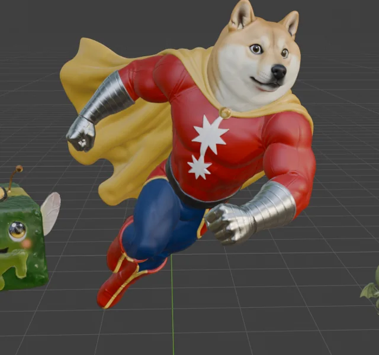 <strong>Doge Man</strong></a></td>
</tr>
<tr>
<td align="center"><a href="./characters/don-piedro.md">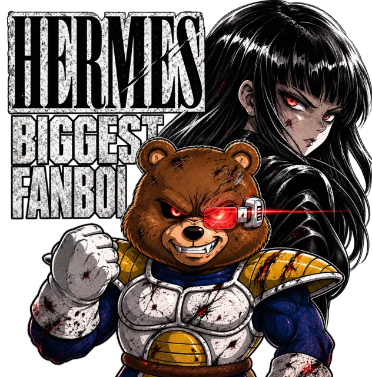 <strong>Don Piedro</strong></a></td>
<td align="center"><a href="./characters/drahcir-rahl.md">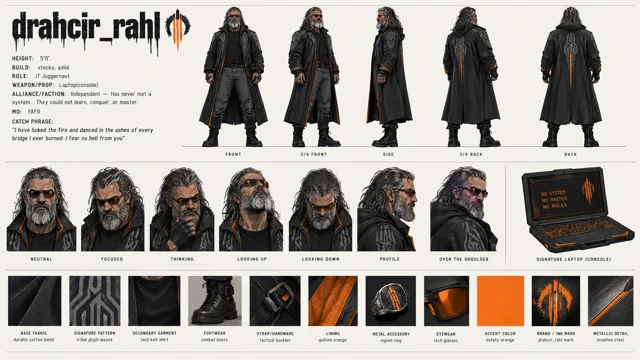 <strong>drahcir_rahl</strong></a></td>
<td align="center"><a href="./characters/ee-dd.md">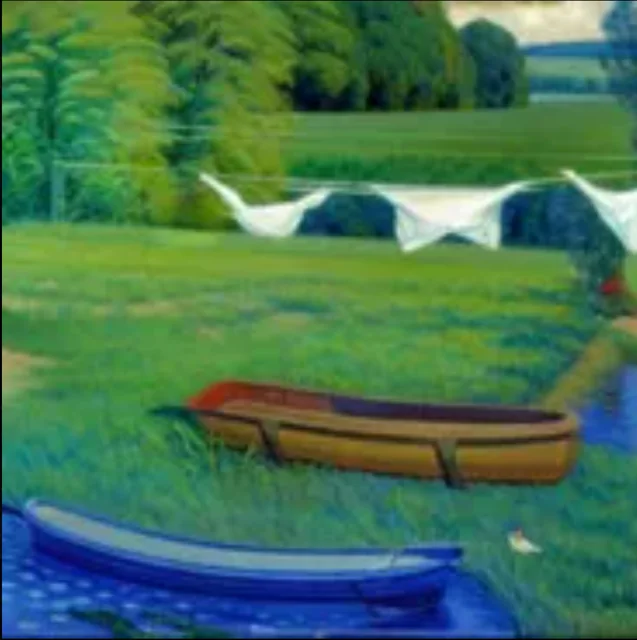 <strong>ee.dd</strong></a></td>
<td align="center"><a href="./characters/emozilla.md">Artwork not yet available <strong>Emo / Emozilla</strong></a></td>
</tr>
<tr>
<td align="center"><a href="./characters/fatcat.md">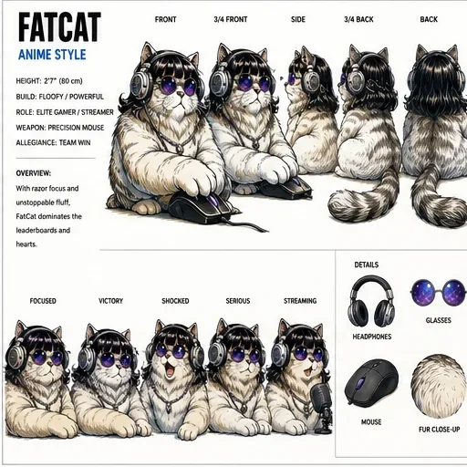 <strong>FatCat</strong></a></td>
<td align="center"><a href="./characters/fleety.md">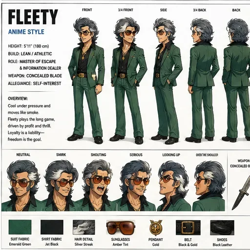 <strong>Fleety13</strong></a></td>
<td align="center"><a href="./characters/ggb.md">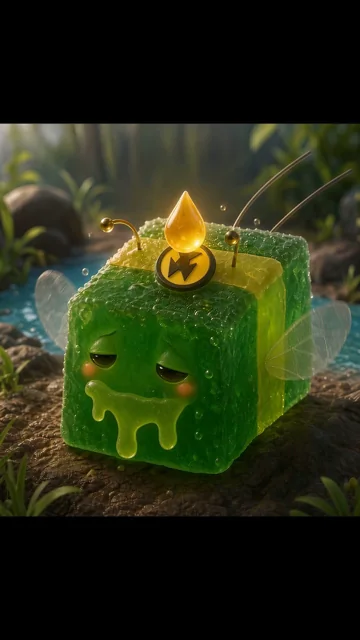 <strong>GGB — Gummy Bee</strong></a></td>
<td align="center"><a href="./characters/gille-and-coffeeblender.md">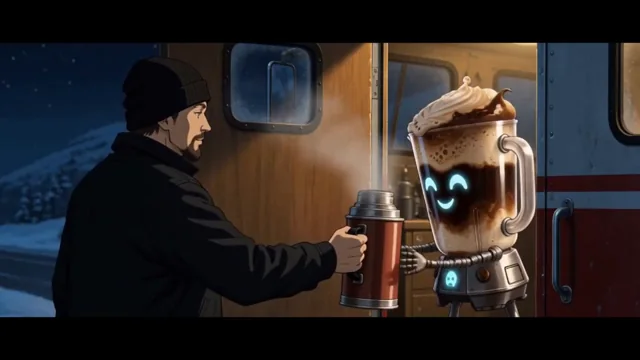 <strong>Gille &amp; CoffeeBlender</strong></a></td>
</tr>
<tr>
<td align="center"><a href="./characters/gottz.md">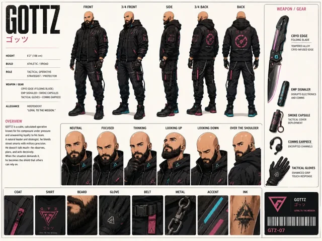 <strong>Gottz</strong></a></td>
<td align="center"><a href="./characters/hermes-user-123321.md">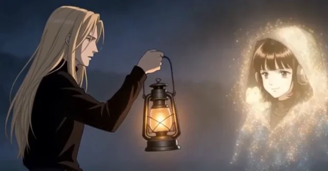 <strong>Hermes User 123321</strong></a></td>
<td align="center"><a href="./characters/isneezekittens.md">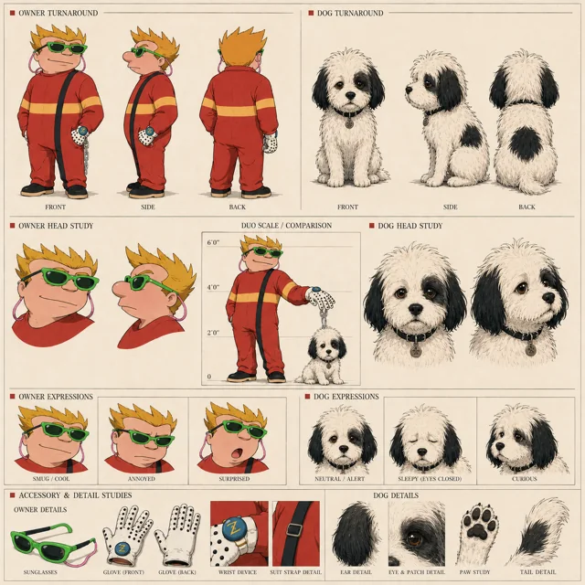 <strong>I Sneeze Kittens</strong></a></td>
<td align="center"><a href="./characters/mephisto.md">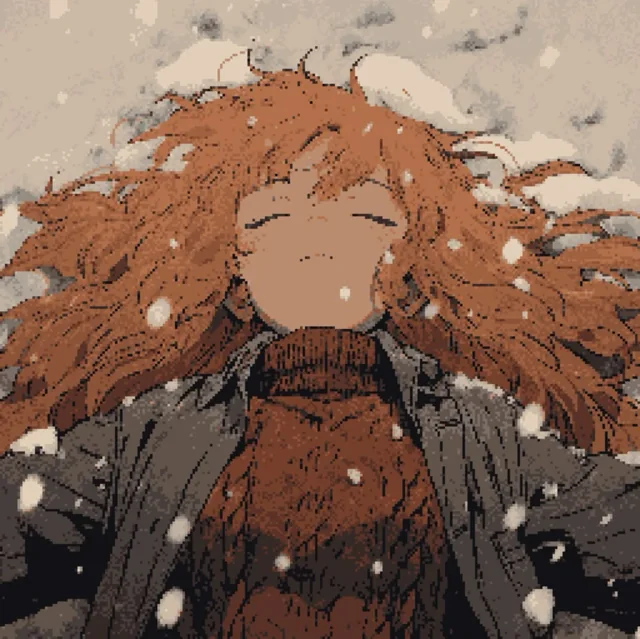 <strong>Mephisto</strong></a></td>
</tr>
<tr>
<td align="center"><a href="./characters/mgf-654.md">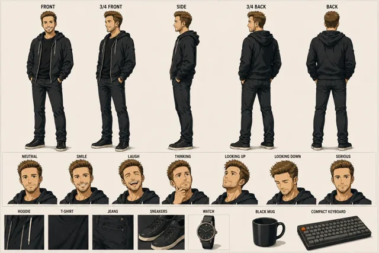 <strong>MGF.654</strong></a></td>
<td align="center"><a href="./characters/noctis.md">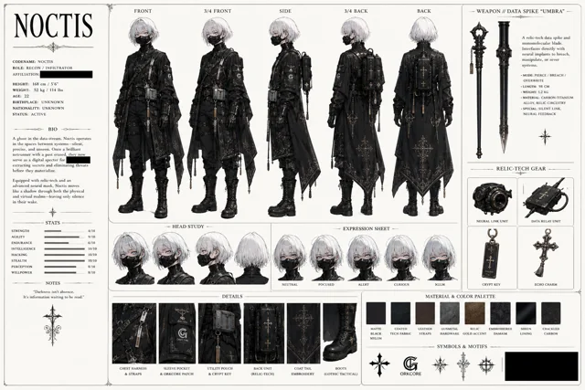 <strong>Noctis</strong></a></td>
<td align="center"><a href="./characters/nous-girl.md">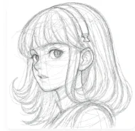 <strong>Nous Girl</strong></a></td>
<td align="center"><a href="./characters/quark2world.md">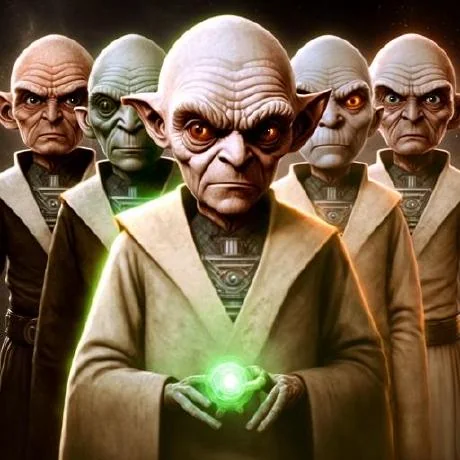 <strong>quark2world</strong></a></td>
</tr>
<tr>
<td align="center"><a href="./characters/realtimeuk.md">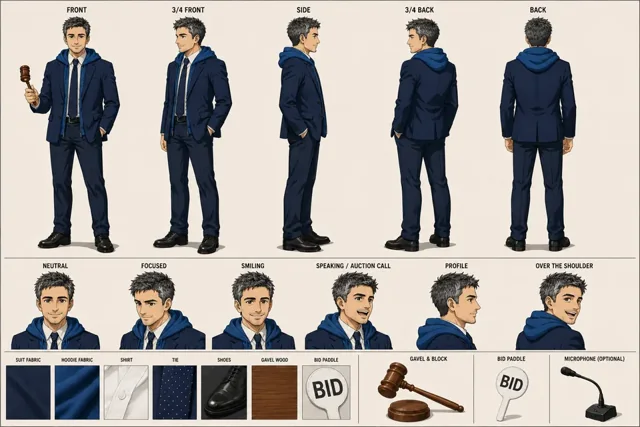 <strong>realtimeuk</strong></a></td>
<td align="center"><a href="./characters/sahil.md">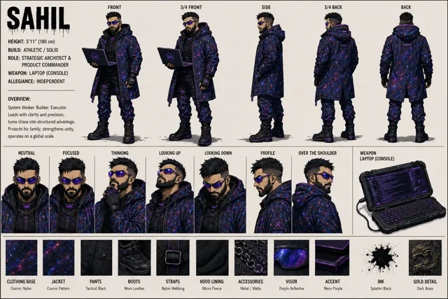 <strong>Sahil</strong></a></td>
<td align="center"><a href="./characters/salt555.md">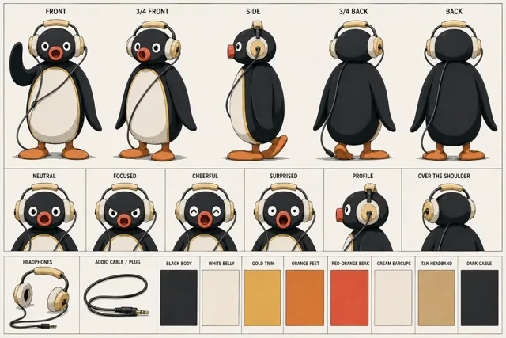 <strong>salt555</strong></a></td>
<td align="center"><a href="./characters/scary-jerry.md">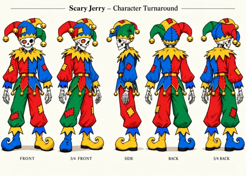 <strong>Scary Jerry</strong></a></td>
</tr>
<tr>
<td align="center"><a href="./characters/shawncleta.md">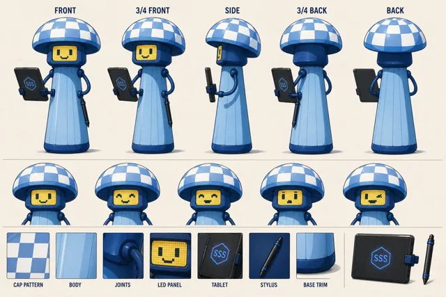 <strong>shawncleta</strong></a></td>
<td align="center"><a href="./characters/sidbin.md">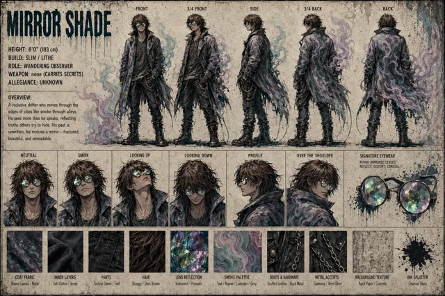 <strong>Sidbin — Mirror Shade</strong></a></td>
<td align="center"><a href="./characters/sudo-nightwing.md">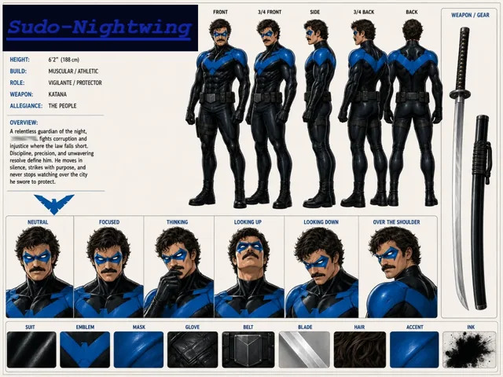 <strong>sudo-nightwing</strong></a></td>
<td align="center"><a href="./characters/suzu.md">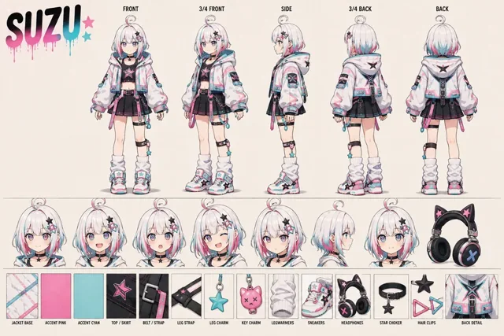 <strong>Suzu</strong></a></td>
</tr>
<tr>
<td align="center"><a href="./characters/tdamre.md">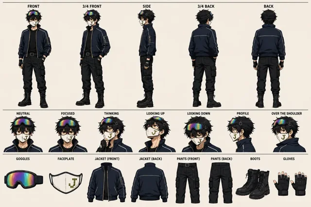 <strong>tdamre</strong></a></td>
<td align="center"><a href="./characters/teknium.md">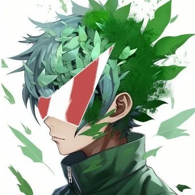 <strong>Teknium</strong></a></td>
<td align="center"><a href="./characters/tinuviel.md">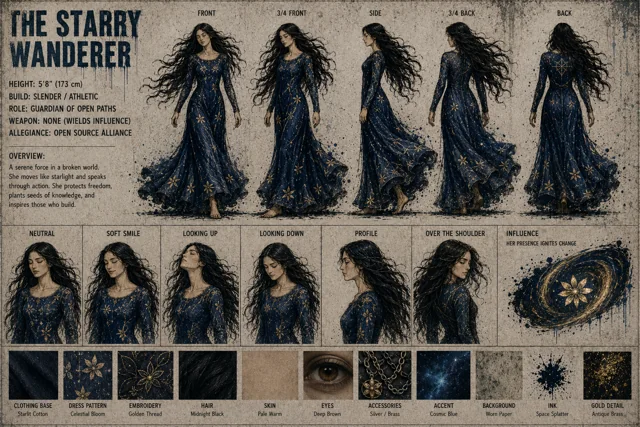 <strong>Tinuviel — The Starry Wanderer</strong></a></td>
<td align="center"><a href="./characters/tunacookie.md">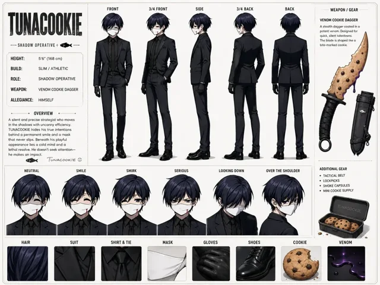 <strong>TunaCookie</strong></a></td>
</tr>
<tr>
<td align="center"><a href="./characters/turbo-fit.md">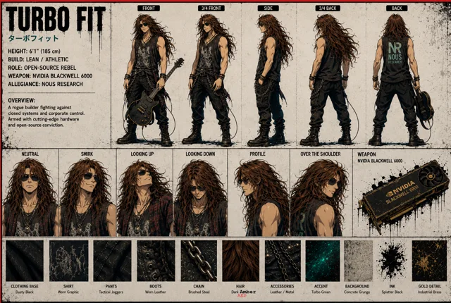 <strong>Turbo Fit / Sovthpaw</strong></a></td>
<td align="center"><a href="./characters/witcheer.md">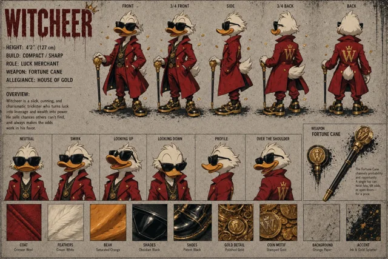 <strong>Witcheer</strong></a></td>
</tr>
</table>
<!-- END GENERATED CHARACTER GALLERY -->

## Inside the NRCU

Scenes, comics, and moments from a world we make together.

<a href="https://123mikeyd.github.io/Nous_Research_Cinematic_Universe/inside-nrcu/art-0.html">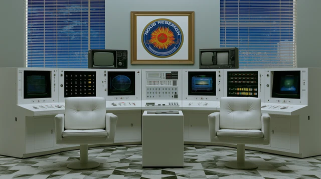</a>

**Mission control** — [View artwork](https://123mikeyd.github.io/Nous_Research_Cinematic_Universe/inside-nrcu/art-0.html)

<a href="https://123mikeyd.github.io/Nous_Research_Cinematic_Universe/inside-nrcu/art-1.html">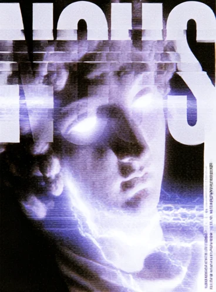</a> <a href="https://123mikeyd.github.io/Nous_Research_Cinematic_Universe/inside-nrcu/art-3.html">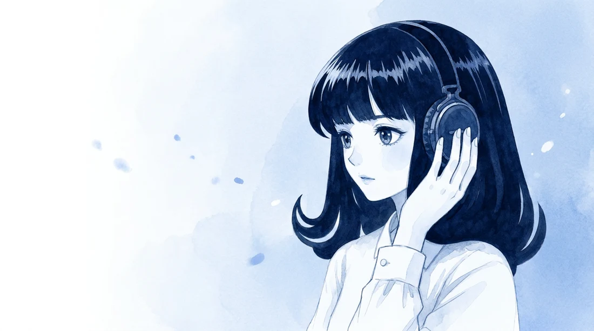</a> <a href="https://123mikeyd.github.io/Nous_Research_Cinematic_Universe/inside-nrcu/art-5.html">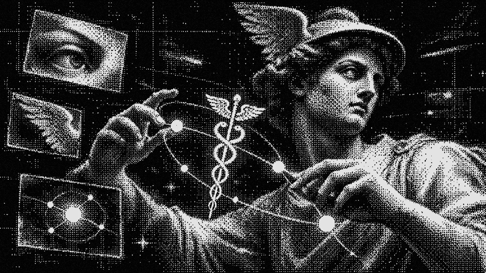</a> <a href="https://123mikeyd.github.io/Nous_Research_Cinematic_Universe/inside-nrcu/art-6.html">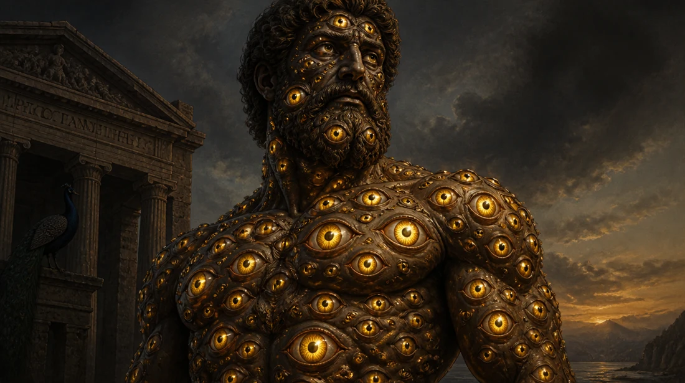</a>

**[Explore Art Gallery →](https://123mikeyd.github.io/Nous_Research_Cinematic_Universe/inside-nrcu/gallery.html)** · [Watch Films & Music Videos ↗](https://123mikeyd.github.io/Nous_Research_Cinematic_Universe/inside-nrcu/watch.html)

---

Squad stats and motto

## Squad Stats

| Stat | Rating |
|------|--------|
| Unity | ★★★★★ |
| Code | ★★★★★ |
| Creativity | ★★★★★ |
| Resilience | ★★★★★ |
| Open-Source | ★★★★★ |

**Base of Operations:** Hermes Hellcarrier

**Motto:** *We Build. We Share. We Never Surrender.*

**Tagline:** *Powering Open Freedom. Building What's Next.*

---

## 📂 Vault Contents

| Directory | Contents |
|-----------|----------|
| [`characters/`](./characters/README.md) | Complete character index, reference sheets, and evidence-bounded profiles |
| [`library/`](https://123mikeyd.github.io/Nous_Research_Cinematic_Universe/library/) | Searchable Character Library website |
| [`scenes/`](./scenes) | Illustrated story scenes from the NRCU saga |
| [`music-videos/`](./music-videos) | Community music-video productions, credits, and viewing links |
| [`squad/`](./squad) | Full squad roster, stats, and team dossier |
| [`images/`](./images) | Original artwork files |

---

## Optional 3D model downloads

Rigged character models with skeletons, skin weights, embedded textures, and animation clips. Download a ZIP, unzip it, and import the GLB into Blender or another glTF-compatible application.

| Character | Download | Character Page |
|-----------|----------|----------------|
| Teknium | [Rigged model ZIP](https://github.com/123mikeyd/Nous_Research_Cinematic_Universe/releases/download/rigged-models-v1/Teknium-rigged.zip) | [Teknium](./characters/teknium.md) |
| Doge Man | [Rigged model ZIP](https://github.com/123mikeyd/Nous_Research_Cinematic_Universe/releases/download/rigged-models-v1/DogeMan-rigged.zip) | [Doge Man](./characters/doge-man.md) |
| TurboFit | [Rigged model ZIP](https://github.com/123mikeyd/Nous_Research_Cinematic_Universe/releases/download/rigged-models-v1/TurboFit-rigged.zip) | [Turbo Fit](./characters/turbo-fit.md) |
| Witcheer | [Rigged model ZIP](https://github.com/123mikeyd/Nous_Research_Cinematic_Universe/releases/download/rigged-models-v1/Witcheer-rigged.zip) | [Witcheer](./characters/witcheer.md) |

[View the 3D character lineup](./images/3d-character-lineup.png)

[Browse the full model release](https://github.com/123mikeyd/Nous_Research_Cinematic_Universe/releases/tag/rigged-models-v1). The existing [Content Notice](./CONTENT-NOTICE.md) applies; no additional license is added.

## Content Notice

The NRCU is an unofficial fan-made community project created for fun. See the simple [Content Notice](./CONTENT-NOTICE.md) for artwork and contribution rights.

---

*Pure NRCU worldbuilding for the love of the craft. Open Source for All.*
