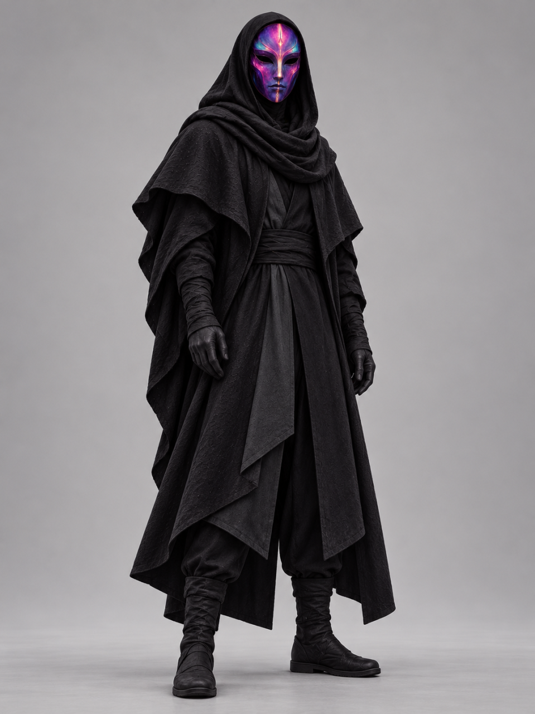
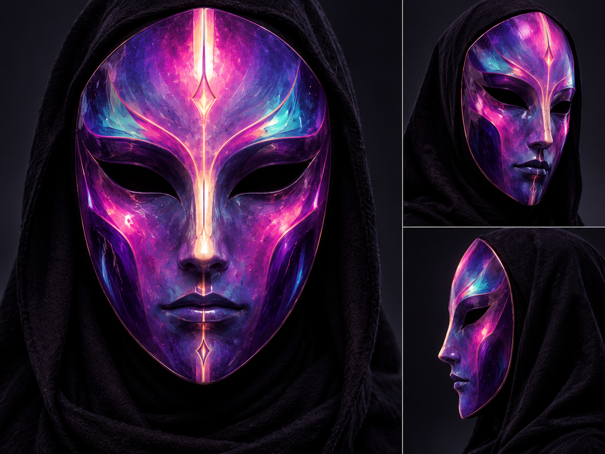

# ArtsBro

**Archive:** Nous

[Mask details](./sheets/artsbro.md) · [All characters](./README.md)

## Creator credit

**ArtsBro / Arts Bro — NRCU co-artist.** Arts Bro created the community music video [Thank You Nous Research](../music-videos/thank-you-nous-research-arts-bro.md). This is a real creator credit, not an in-universe role or affiliation. See [co-artists & creative credits](../CREDITS.md).

## Character reference

ArtsBro wears layered black hooded robes, gloves, and boots. His face stays hidden behind a full mask with purple, magenta, and cyan coloring and a bright central motif.

## Mask details

Story roles, affiliations, powers, and relationships remain open unless separately established. Archive inclusion does not assert employment or fictional allegiance.
