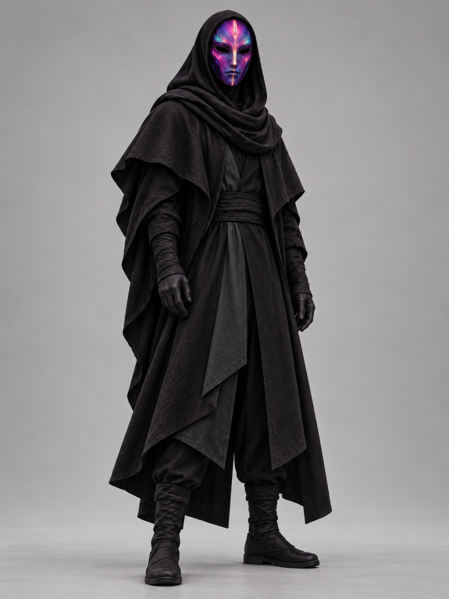
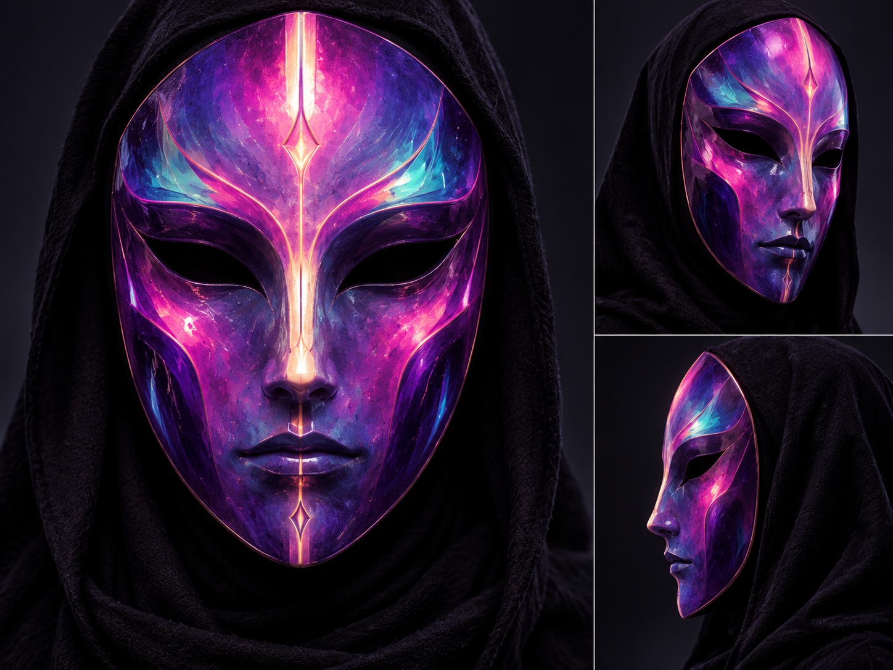

# ArtsBro

**Archive:** Nous

[Mask details](./sheets/artsbro.md) · [All characters](./README.md)

## Creator credit

**ArtsBro / Arts Bro — NRCU co-artist.** Arts Bro created the community music video [Thank You Nous Research](../music-videos/thank-you-nous-research-arts-bro.md). This is a real creator credit, not an in-universe role or affiliation. See [co-artists & creative credits](../CREDITS.md).

## The artist behind the mask

ArtsBro is a mysterious artist who lets his work speak for him. He prefers creating art to being in the spotlight, telling stories that express his deep love and respect for the Nous Research team.

His community video, **“Thank You Nous Research,”** moved the team to tears—a tribute that put the people he celebrates at the center of the story.

Behind the fully concealed face is an artist who chooses to share through what he creates. His reasons are his own; the art tells the story.

## Character reference

ArtsBro wears layered black hooded robes, gloves, and boots. His face stays hidden behind a full mask with purple, magenta, and cyan coloring and a bright central motif.

## Mask details

Story roles, affiliations, powers, and relationships remain open unless separately established. Archive inclusion does not assert employment or fictional allegiance.
