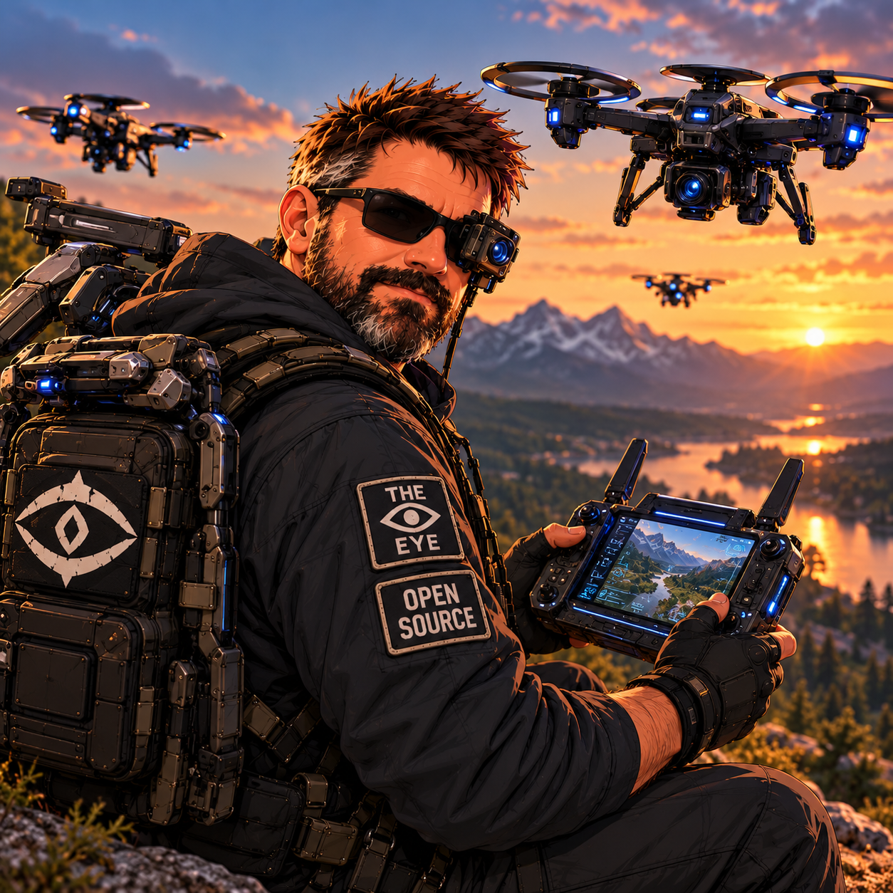

# 👁️ Locutus of the Eye

## Core Stats

| Attribute | Value |
|-----------|-------|
| **Height** | 6'2" |
| **Role** | Observer — Systems Builder / Drone Operator |
| **Signature Ability** | The Observer’s Eye |
| **Signature Items** | Black Sunglasses, Modular Backpack, Drone Controller |
| **Insignia** | The Eye / Open Source |

## Focus

Observation, Analysis, Security, Building, Exploration

## Overview

> Observe. Analyze. Secure. Build.
>
> Same curiosity. More context.

Locutus of the Eye is a hands-on builder with an observer’s instinct: look closely, connect the dots, and understand what is really happening before making a move. Whether tracing a problem through a complex system or scouting a mountain valley through a drone feed, he turns scattered information into something useful.

Behind the black sunglasses is a human, not a machine. His gear extends his reach, but curiosity does the work. The goal is not to see everything—it is to notice what matters and build something better from it.

## Signature Ability

### The Observer’s Eye

- **See hidden systems:** Recognize the structures beneath the surface.
- **Connect the dots:** Bring separate observations into a coherent picture.
- **Filter the noise:** Separate useful signals from distractions.
- **Find problems early:** Notice small failures before they become bigger ones.
- **Turn complexity into clarity:** Make difficult systems understandable and actionable.

## Signature Items

- **Black Sunglasses:** His everyday visual signature, with or without additional equipment.
- **Removable Optic:** An optional blue-lit sensor attachment beside one lens; detachable technology, not a permanent implant.
- **Modular Backpack:** A rugged field pack with equipment mounts, reinforced panels, and a prominent Eye emblem.
- **Drone Controller:** A futuristic DJI-like handheld controller with dual sticks, antennas, and an integrated live-view screen.
- **Scout Drones:** Compact aerial camera platforms that can deploy into the field or fold onto the backpack.
- **Eye / Open Source Patches:** Readable, high-contrast insignia on dark fabric.

## Material & Texture Guide

| Material | Description |
|----------|-------------|
| Hair | Short, spiked brown hair with warm highlights |
| Beard | Full dark beard with gray strands |
| Eyewear | Black frames, dark lenses |
| Clothing Base | Matte charcoal / black hooded field jacket |
| Trousers | Muted gray / olive cargo fabric |
| Footwear | Dark, rugged field shoes or boots |
| Backpack | Technical fabric, reinforced panels, webbing, metal hardware |
| Patches | Cream / white markings on dark cloth |
| Technology | Graphite housings and electric-blue sensor lights |
| Lighting | Warm amber highlights against cool blue electronics |

## Character Reference Sheet Views

- **Body:** Front, 3/4 Front, Side, 3/4 Back, Back
- **Expressions:** Neutral, Grin, Thinking, Determined, Skeptical, Laughing, Serious, Sarcastic
- **Equipment:** Backpack, Folded / Deployed Drone, Removable Optic, Controller, Insignia

[View character sheets](sheets/locutus-of-the-eye.md)

## Community Reference

[Discord message](https://discord.com/channels/1053877538025386074/1537215012601602068/1552306854745350185) — access may require server membership.

## Design Notes

Keep Locutus recognizably human and practical: spiked brown hair, full beard, black sunglasses, a dark hooded jacket, and a substantial technical backpack. His silhouette should feel like a builder prepared for the field, not a faceless armored soldier.

The **Eye logo belongs on the shoulder and backpack**. An Eye-branded hat is optional. **Sunglasses are standard; the removable optic and drones are optional.** The character must remain recognizable without the full equipment loadout.

Use functional controls, clear screens, compact machinery, and restrained blue illumination. No permanent mechanical face, glowing replacement eyes, Linux logos, or penguin mascots.
