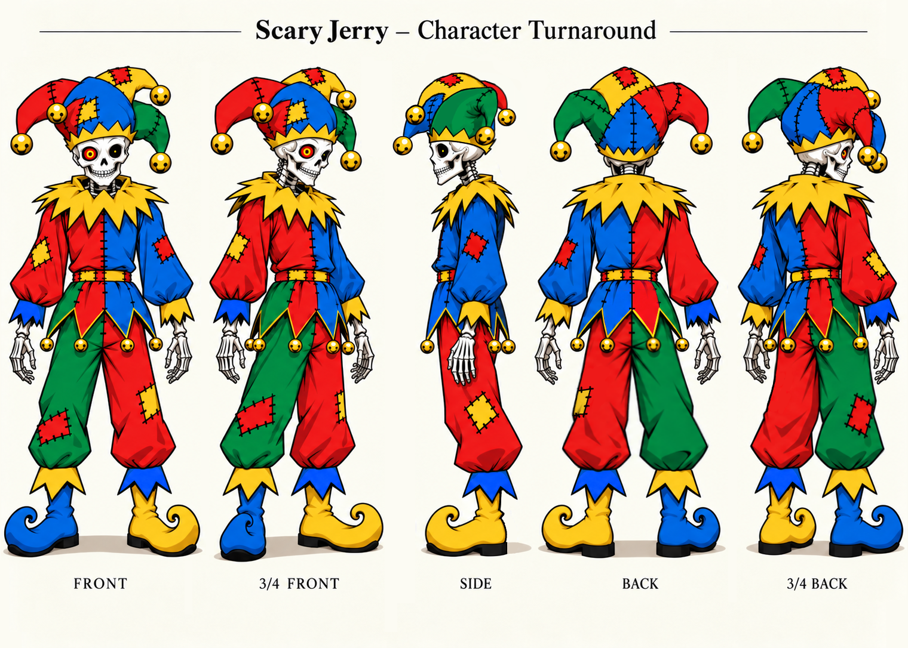

# Scary Jerry

Also known as **ScaryJerry**.

## Visual reference

A skeletal jester wearing a stitched red, blue, green, and yellow outfit, a bell-tipped cap, and mismatched curled shoes. His skull grin and striking red-and-yellow eye give the colorful design an eerie edge.

## Personality

Behind the skeletal grin, Scary Jerry is a helpful community member who enjoys having fun. He offers straightforward explanations, dry observations, and an appreciation for impressive things—even when he isn’t a fan of whoever made them.

Character reference sheet included for archival reference; no reuse license is stated.

[All Nous characters](./README.md) · [Content notice](../CONTENT-NOTICE.md)
