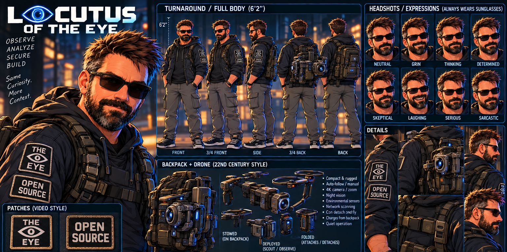

# Locutus of the Eye — Character Sheets

[Character profile](../locutus-of-the-eye.md) · [All characters](../README.md)

## Primary Portrait

Original supplied artwork: sunglasses, optional removable optic, Eye shoulder and backpack markings, drone controller, and deployed scout drones. This equipment-heavy scene is a reference, not a requirement for every appearance.

## Turnaround, Expressions & Equipment

A native-resolution upper crop of the supplied turnaround sheet, preserving the title, height, five body views, expressions, backpack and drone studies, and patch references. The lower strip containing legacy penguin imagery is omitted to follow the master pack’s written no-Linux-logo guidance. This is an edited crop of existing art, not a newly generated illustration.

## Current Design Rules

- Eye emblem on shoulder and backpack; an Eye-branded hat is optional.
- Black sunglasses are standard.
- Removable optic and drones are optional.
- Futuristic DJI-like controller when piloting drones.
- No Linux logos or penguin mascots.

Character and reference artwork contributed by [KeyArgo](https://github.com/KeyArgo). The existing [Content Notice](../../CONTENT-NOTICE.md) applies; no additional reuse license is granted.
