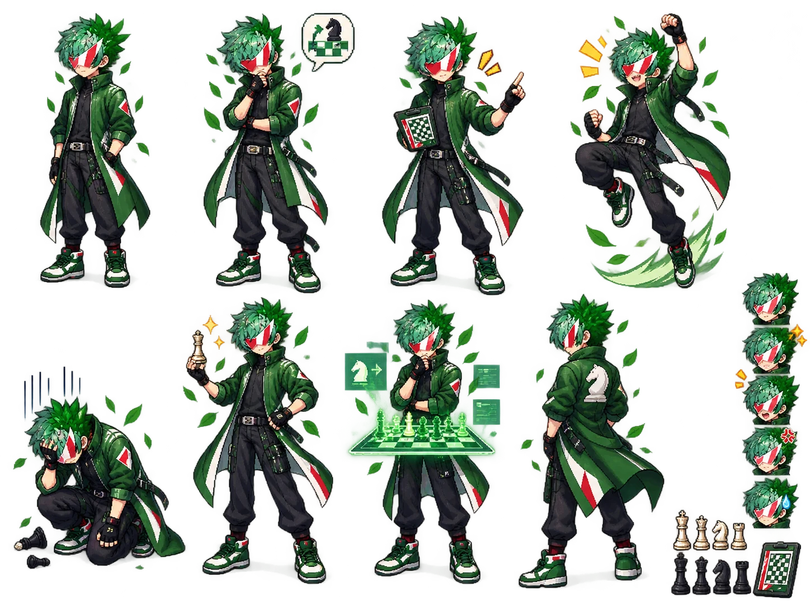

# Teknium — Supplementary art

[Character profile and established reference](../teknium.md) · [Visual library](../../library/index.html)

Individually approved supplementary art. The established primary reference and character lore remain unchanged.

## Anime alternate

From [Sahil’s Hermes Multiverse collection](https://github.com/Sahil-SS9/hermes-multiverse).

## Chess-themed alternate — pose and expression sheet

[Content notice](../../CONTENT-NOTICE.md).
